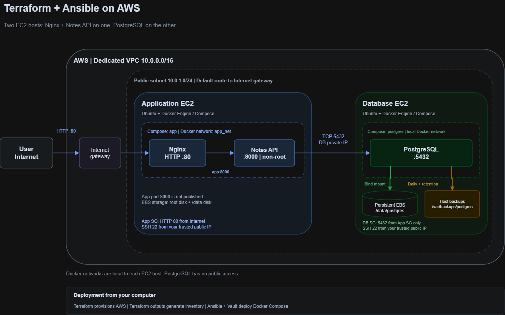

# Terraform and Ansible project

An automated two-host AWS deployment that provisions cloud infrastructure with **Terraform** and configures **Docker Engine**, **Docker Compose**, an **Nginx + Flask Notes API** stack, and a **PostgreSQL** database with automated backups using **Ansible**.

## Architecture




### Network & Security Design

| Component | Host / Scope | Exposure & Access Control | Purpose | 
| ----- | ----- | ----- | ----- | 
| **Nginx** (`nginx:1.27.4-alpine`) | App EC2 (`app_net`) | Publicly published on port `80` (`0.0.0.0:80->80/tcp`) | Reverse proxy forwarding requests to `http://app:8000` | 
| **Notes API** (`notes-app:1.0.0`) | App EC2 (`app_net`) | **Unpublished** (`EXPOSE 8000` only); runs as non-root UID/GID `1000:1000` | Flask + `psycopg2` JSON API managing records in PostgreSQL | 
| **PostgreSQL** (`postgres:16.4`) | DB EC2 | Bound exclusively to DB host private IP (`<db_private_ip>:5432:5432`); `db-sg` allows TCP `5432` **only** from `app-sg` | Relational database storing the `notes` table | 
| **Persistent Storage** | DB EC2 (`/dev/nvme1n1`) | Formatted `ext4` (`LABEL=data`), mounted at `/data` via `/etc/fstab` | Stores `/data/postgres` outside container writable layers | 
| **SSH Management** | Both EC2 Hosts | Restricted to `var.my_ip` (`/32` CIDR) in both security groups | Used by Ansible for host configuration and deployment | 

## Repository Structure

```
.
├── ansible/
│   ├── ansible.cfg                        # Ansible defaults, SSH pipelining, Vault password path
│   ├── site.yml                           # Main playbook (storage, docker, postgres, backup, app)
│   ├── restore.yml                        # Playbook to restore PostgreSQL from the latest backup
│   ├── group_vars/all/
│   │   ├── vars.yml                       # Non-sensitive shared variables and device paths
│   │   └── vault.yml                      # Ansible Vault encrypted database credentials
│   └── roles/
│       ├── storage/                       # Formats and mounts attached EBS volume at /data
│       ├── docker/                        # Installs Docker Engine, Compose plugin, enables on boot
│       ├── postgres/                      # Deploys PostgreSQL Compose stack, init.sql, restore script
│       ├── backup/                        # Configures daily pg_backup.sh cron job and retention
│       └── app/                           # Builds app image, templates Nginx/Compose, checks health
├── app/
│   ├── Dockerfile                         # Pinned Python 3.12 image, non-root user, healthcheck
│   ├── app.py                             # Flask JSON API (/health, GET /notes, POST /notes)
│   ├── requirements.txt                   # Pinned Flask and psycopg2-binary versions
│   └── .dockerignore
├── scripts/
│   ├── deploy.sh                          # End-to-end workflow: Terraform -> Inventory -> Ansible
│   └── generate_inventory.sh              # Populates ansible/inventory.ini from Terraform outputs
└── terraform/
    ├── main.tf                            # AWS provider (~> 6.0) and default tags
    ├── network.tf                         # Dedicated VPC, public subnet, IGW, and route table
    ├── app.tf                             # App EC2 instance, EBS volume, key pair, and app SG
    ├── db.tf                              # DB EC2 instance, EBS volume, and DB SG
    ├── variables.tf                       # Configurable inputs (region, my_ip, instance_type, etc.)
    ├── outputs.tf                         # Public and private IP outputs for App and DB instances
    └── terraform.tfvars.example           # Example variable file for trusted IP configuration

```

## Prerequisites

Ensure the following tools and credentials are configured on your local machine before deploying:

1. **AWS Credentials**: Configured via `aws configure` or environment variables (`AWS_ACCESS_KEY_ID`, `AWS_SECRET_ACCESS_KEY`, `AWS_REGION`) with permissions to manage VPC, EC2, EBS, and Security Groups.

2. **Terraform**: Version `>= 1.5` installed.

3. **Ansible**: `ansible-core` installed along with the required Galaxy collections:

   ```
   ansible-galaxy collection install community.docker community.general ansible.posix
   
   ```

4. **SSH Key Pair**: An SSH key pair located at `~/.ssh/devops_lab` and `~/.ssh/devops_lab.pub` (the default paths in Terraform and Ansible). Generate one if needed:

   ```
   ssh-keygen -t ed25519 -f ~/.ssh/devops_lab -N ""
   
   ```

## Deployment Instructions

### 1. Configure Your Trusted Public IP for Terraform

Copy the example variable file and set `my_ip` to your current public IPv4 address in `/32` CIDR notation:

```
cp terraform/terraform.tfvars.example terraform/terraform.tfvars
echo "my_ip = \"$(curl -s https://checkip.amazonaws.com)/32\"" > terraform/terraform.tfvars

```

### 2. Configure Ansible Vault Credentials

`ansible/ansible.cfg` reads the Vault password from `.vault_pass` in the repository root (which is excluded from Git).

Create `.vault_pass` and encrypt your database credentials in `ansible/group_vars/all/vault.yml`:

```
# 1. Create your local Vault password file
echo "your-strong-vault-password" > .vault_pass
chmod 600 .vault_pass

# 2. Create the encrypted vault.yml with your PostgreSQL passwords
cat << 'EOF' > /tmp/vault_plain.yml
---
vault_db_password: "ChangeMe_AppDbPassword123!"
vault_postgres_password: "ChangeMe_PostgresRoot123!"
EOF

ansible-vault encrypt /tmp/vault_plain.yml \
  --vault-password-file .vault_pass \
  --output ansible/group_vars/all/vault.yml
rm -f /tmp/vault_plain.yml

```

### 3. Run the Automated Deployment Workflow

Execute the deployment script from the repository root:

```
./scripts/deploy.sh

```

What `./scripts/deploy.sh` performs automatically:

1. Runs `terraform -chdir=terraform init` and `terraform -chdir=terraform apply -auto-approve` to provision the VPC, subnet, internet gateway, security groups, two Ubuntu 24.04 `t3.micro` instances, and attached EBS volumes.

2. Runs `./scripts/generate_inventory.sh`, which queries `terraform output` (`app_public_ip`, `db_public_ip`, `db_private_ip`) and writes `ansible/inventory.ini`.

3. Runs `ansible-playbook site.yml`, which waits for SSH and `cloud-init`, mounts the persistent EBS volumes at `/data`, installs Docker Engine and Compose v2, deploys PostgreSQL on the DB host, waits for TCP port `5432` readiness on the DB host's private IP, builds and starts the Flask app and Nginx containers on the App host, and verifies `http://127.0.0.1/health` through Nginx.

## 3. End-to-End Test 

### 1. Deploy Everything from Scratch

```
./scripts/deploy.sh

```

### 2. Verify Idempotency (Second Run = 0 Restarts)

```
cd ansible && ansible-playbook site.yml && cd ..

```

### 3. Test Creating & Reading Records via Nginx

```
APP_IP=$(terraform -chdir=terraform output -raw app_public_ip)

# Create two test notes
curl -s -X POST "http://${APP_IP}/notes"   -H "Content-Type: application/json"   -d '{"title": "First Note", "body": "Before backup"}' | jq .

curl -s -X POST "http://${APP_IP}/notes"   -H "Content-Type: application/json"   -d '{"title": "Second Note", "body": "Also backed up"}' | jq .

# List notes
curl -s "http://${APP_IP}/notes" | jq .

```

### 4. Demonstrate Backup & Restore of Deleted Test Data (Explicit Assignment Requirement)

```
# 1. Trigger an immediate backup on the DB server
cd ansible && ansible db -b -m command -a "/usr/local/bin/pg_backup.sh"

# 2. (inside ansible/) Delete all rows from the notes table to simulate accidental data loss
ansible db -b -m command -a "docker exec postgres psql -U notes_user -d notesdb -c 'DELETE FROM notes;'"

# 3. Prove the notes are gone (returns [])
curl -s "http://${APP_IP}/notes" | jq .

# 4.(inside ansible/) Run the restore playbook
ansible-playbook restore.yml

# 5. Prove the deleted notes are restored!
curl -s "http://${APP_IP}/notes" | jq .

```

### 5. Prove Database Port 5432 Is Inaccessible from the Internet

```
DB_IP=$(terraform -chdir=terraform output -raw db_public_ip)
nc -zv -w 5 "${DB_IP}" 5432 || echo "PASS: Port 5432 is blocked from the public internet"

```

### 6. Clean Up All AWS Resources

```
terraform -chdir=terraform destroy -auto-approve

```

## Known Limitations

* **HTTP Only (No TLS)**: Nginx listens on port `80` over plain HTTP because no domain name or TLS certificate is provisioned for this lab environment.

* **Public Subnet for Database Host**: As permitted by the assignment specification, both EC2 instances reside in a public subnet so Ansible can reach them directly via SSH (`var.my_ip/32`) and download apt/Docker packages without incurring NAT Gateway costs. PostgreSQL port `5432` remains completely inaccessible from the internet via both Security Group rules (`app-sg` only) and private IP socket binding.

* **Local Host Backups**: Daily `pg_dump` backups are written to `/var/backups/postgres` on the DB host's root EBS volume (separate from the `/data` EBS volume housing live PostgreSQL data). In production, backups would also be replicated off-host to Amazon S3.


## Attribution & External Components

* **Application Code**: The Flask Notes API (`app/app.py`) was written specifically for this assignment using standard `Flask` and `psycopg2` patterns.

* **Container Images & Modules**: Uses official Docker Hub images (`nginx:1.27.4-alpine`, `postgres:16.4`, `python:3.12.11-slim-bookworm`), the official HashiCorp AWS Terraform provider (`hashicorp/aws`), and official Ansible Galaxy collections (`community.docker`, `community.general`, `ansible.posix`).